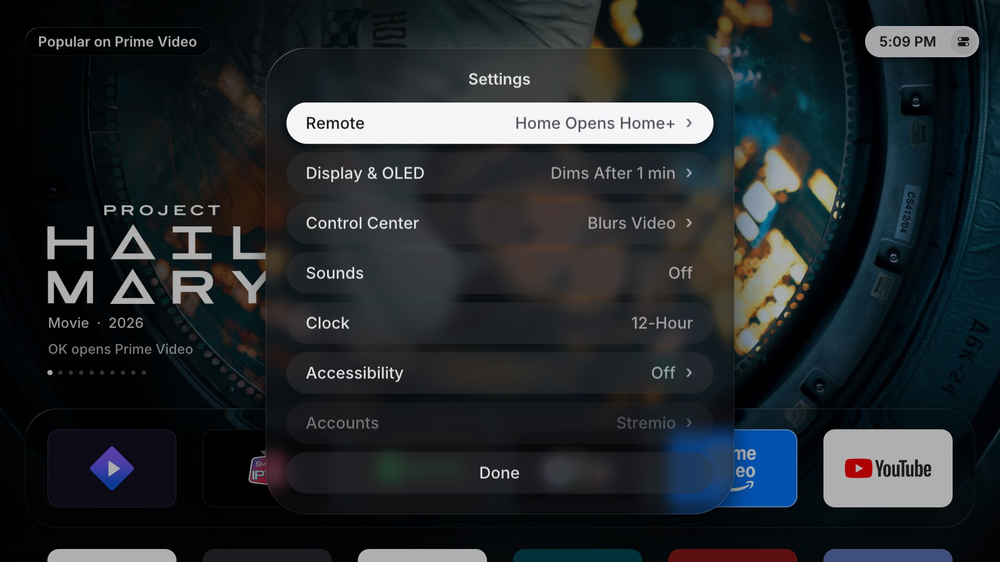
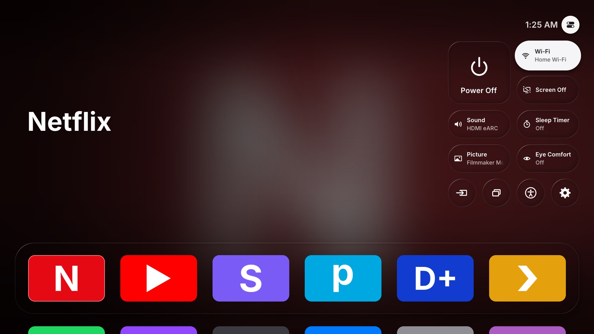
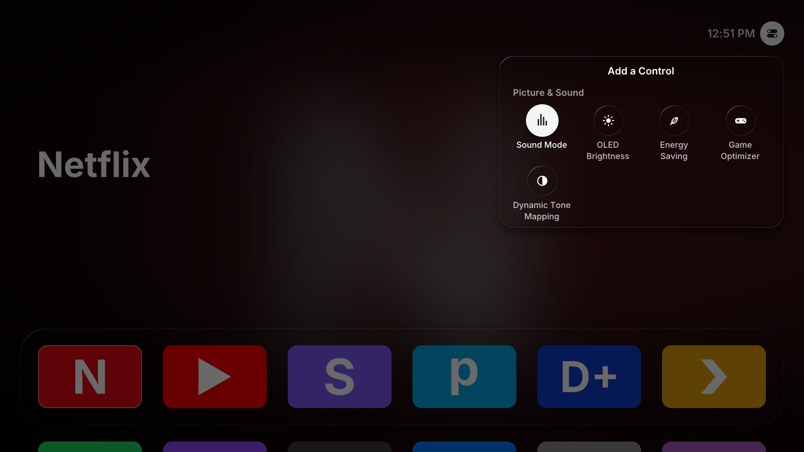
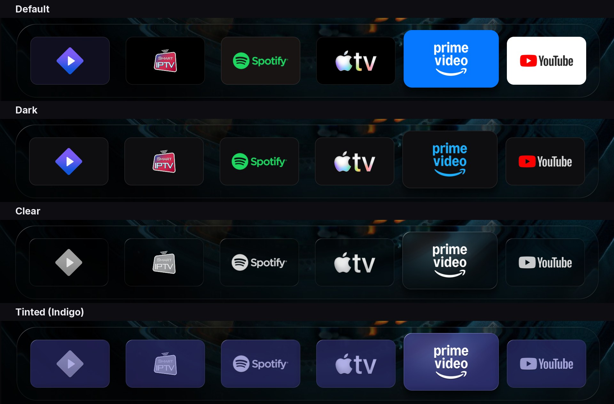
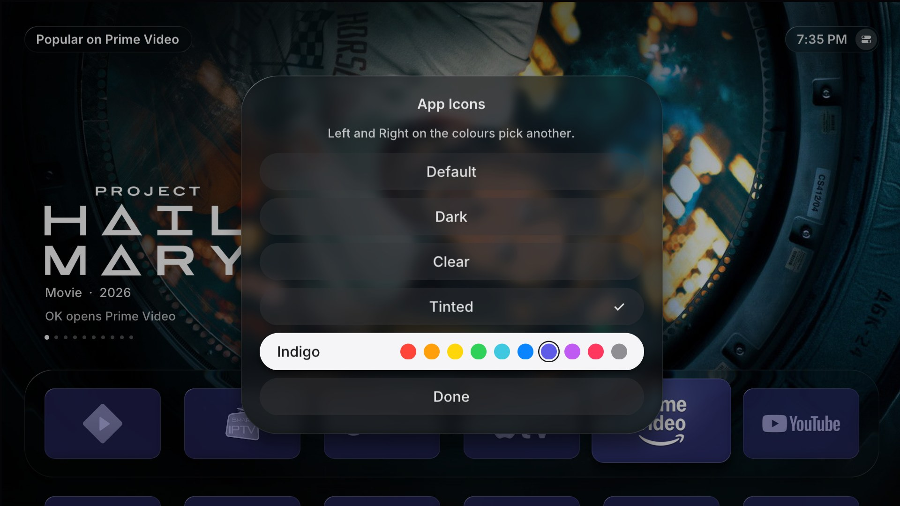

# Home+

A tvOS-style home screen for rooted LG webOS TVs, in a Liquid Glass look, with Continue Watching from Stremio, Trakt, Jellyfin and Plex.


*Screenshots show a real TV's apps and Continue Watching. The Jellyfin and Plex ones use placeholder shows, and the Control Center ones placeholder apps.*

> **Not affiliated with LG, Apple, Stremio, Trakt, Jellyfin, Plex or TMDB.** Home+ uses the TMDB API but is not endorsed or certified by TMDB. Home+ is an independent project. tvOS and Liquid Glass are Apple's names for Apple's designs; Home+ only borrows the look. It runs on **rooted** TVs and uses Stremio's, Trakt's and Plex's web APIs unofficially. Use it at your own risk.

## What it does

- **Top Shelf:** focus an app in the top row and the screen fills with its pictures, one title at a time, like tvOS. Stremio, Jellyfin and Plex show what you're partway through; streaming apps show what's popular on them (with a free TMDB key); other apps get a glow taken from their icon.
- **Liquid Glass:** the dock, clock, buttons and menus bend the light at their edges and blur only what sits behind text. Focused tiles lift, sway and catch a moving light. The Magic Remote pointer steers that light.
- **App icons:** like iOS 26's, every app can show its own colours, sit on a dark tile, or turn to glass: clear, or tinted in one of ten colours.
- **Motion and sound:** everything moves on springs, and menus grow out of the button that opened them. A soft tick plays when focus moves; **Settings → Sounds** turns it off.
- **Continue Watching:** what you're partway through in Stremio (with your Trakt progress), Jellyfin or Plex, newest first. It turns to the next title every 10 seconds (or stays still: **Settings → Display & OLED → Top Shelf**); press **Up**, then **Left** and **Right**, to step through them. You sign in with a code or a QR code, so no password is typed on the TV.
- **Recents:** an App Switcher for the apps you opened that are still running, most recent first. Apps webOS runs by itself (preloaded, or started again in the background) stay out. Open them, close them one by one, or close them all. Press **Back** on the first app to open it.
- **Your layout:** hold **OK** on an app to move it, move it to the front, hide it, or delete it from the TV (like tvOS's Delete App; LG's built-in apps, the Homebrew Channel, LG Input Hook and Home+ itself can't be deleted). Hidden apps collect in a "Hidden" tile at the end.
- **Home button:** optionally, the Home button opens Home+ instead of LG's home screen.
- **OLED care:** the picture drifts by a pixel every minute, and an idle Home+ dims, then goes black.
- **Light on the TV:** a native app (C, SDL2, OpenGL ES 2) that draws nothing while nothing moves. It shares the GPU happily with PicCap and HyperHDR.

## Requirements

- A **rooted** LG TV running webOS, with the **[Homebrew Channel](https://github.com/webosbrew/webos-homebrew-channel)** installed.
- **Tested on:** LG C3 (OLED), webOS 9.2.1 (webOS 24; firmware 23.20.59). Other recent webOS TVs may well work, but haven't been tried. If you try one, please [send a compatibility report](https://github.com/pbalazaar/home-plus/issues/new?template=compatibility.yml), whether it went well or not.
- **Optional:**
  - for Continue Watching, any of: a [Stremio](https://www.stremio.com) account and the Stremio app; a [Jellyfin](https://jellyfin.org) server and the Jellyfin app; a [Plex](https://www.plex.tv) server and the Plex app;
  - a [Trakt](https://trakt.tv) account;
  - [lginputhook](https://github.com/Simon34545/lginputhook), for a Home button without a flash (see [Home button](#home-button)).

## Install

1. Download `com.github.pmiraka.homeplus_<version>_all.ipk` from [Releases](../../releases).
2. Install it with [webOS Dev Manager](https://github.com/webosbrew/dev-manager-desktop) (Apps → Install), or with `ares-install`.
3. Open **Home+** from the app list.

**What the first start does:** Home+ asks the Homebrew Channel for the root access its background service needs, restarts that service and links its boot script into the Homebrew Channel's startup scripts, so it's ready every time the TV starts. You'll see "Setting Up Home+" for a few seconds. Then Home+ asks whether the Home button should open it. You can change that answer any time in Settings.

If something stops it, the screen says what and offers **Try Again**:

| Screen | What it means |
|---|---|
| Homebrew Channel Needed | The Homebrew Channel isn't installed, or isn't running as root. |
| Couldn't Get Permission | The Homebrew Channel refused to give Home+ root access. Check that the TV is rooted and the Homebrew Channel is up to date. |
| Home+ Couldn't Start | Home+'s background service didn't answer. Restarting the TV usually fixes this. |

Updates install the same way. An update resets the service's root access, and Home+ sets it up again the next time it starts.

## Using Home+

| Key | What it does |
|---|---|
| Arrows, **OK** | Move and open. Hold **OK** for an app's options. |
| **Back** | Closes a menu, steps out of Continue Watching or the clock, then jumps to the first app. On the first app it opens Recents. It never leaves Home+. |
| **Red** | Recents |
| **Green** | Settings |
| **Yellow** | The focused app's options |
| **Blue** | Move the focused app (press again when it's in place) |


**Magic Remote pointer:** point at anything and click. Pressing an arrow hands control back to the keys: then OK presses what the keys focused, wherever the cursor happens to be. Moving the pointer clearly takes over again.

From the top row, press **Up** to reach the clock at the top right, as on tvOS; **OK** on it opens the Control Center. On Stremio, Jellyfin or Plex, Up goes into Continue Watching first, as the chevron above the dock shows. The remote's own **Settings** and **Input** keys open LG's menus; apps never receive them. With LG Input Hook installed (see [Home button](#home-button)), **Settings → Remote → Settings Button** makes the Settings key open the Control Center: over Home+, and over any other app or input too, where it opens on top of what's playing and the video carries on underneath (see below). **Input Button** does the same for the Input key, with the Control Center's inputs on their own: **OK** switches to one, and **Back** or the Input key again closes them.





**Control Center**, like tvOS's, opens from the clock: glass tiles under it for **Power Off**, **Wi-Fi** (your network; OK opens LG's network settings), **Screen Off** (sound keeps playing; any key brings the picture back), **Sound** (OK switches between TV speakers and HDMI ARC or eARC, and any other output the TV has used, like Optical: not a full picker), **Sleep Timer** (the minutes left; OK steps through LG's 10 to 240 minutes, and the TV turns off when it runs out), **Picture** (the picture mode; OK lists the modes LG offers for what's on, which differ for HDR and Dolby Vision), **Eye Comfort** (OK turns it on or off), and round buttons for **Inputs** (Live TV and the HDMI ports by LG's names, with what's plugged in, like "Soundbar · PS5"), **Recents**, **Accessibility** and **Settings**. A name too long for its tile scrolls while the tile has focus. Picture and Inputs open their list in the Control Center's place.

**Over other apps**, the Settings key opens the same Control Center on top of what's playing, as LG's Quick Settings would open, and the video keeps playing under it. Its glass, like tvOS's, takes its look from the picture behind it: the TV hands Home+ a small frame of the video about three times a second, blurred, so the glass carries the picture's colours rather than its detail, and the corner behind the clock dims only where the picture is bright (a channel's logo, say). The TV can't always capture its video: protected video (Netflix and the like) gives no frames, and nor does any video while PicCap captures it, as the TV captures video for one app at a time. The glass is then a clear tint, unless **Blur Over Video** (Settings → Control Center) pauses PicCap while the Control Center is open. Everything works there as in Home+, editing too, with Home+'s focus sounds and its Reduce Motion and Reduce Transparency settings; **Back** closes it, and so does the Settings key again. Recents, Accessibility and Settings open Home+.



**Make it yours**, like iOS 18's: hold **OK** on a control and choose **Edit Controls**. The controls wobble; **OK** picks one up and the arrows move it, holding **OK** changes its size (Small, Wide, Large) or removes it, and the **+** slot adds one: **Sound Mode**, **OLED Brightness**, **Energy Saving**, **Game Optimizer** and **Dynamic Tone Mapping** (whichever your TV has), and **Ambient Light** and **Screen Capture** when HyperHDR and PicCap are installed (they turn HyperHDR's LEDs and PicCap's capture on and off). There's room for seven rows: a size or a control that won't fit is turned down, and the Control Center says so. **Reset** puts it back, and **Back** is done; every change is saved as you make it. Each action is also a service method, so a script, a home automation or a key-mapping tool running on the TV can use it with `luna-send` (as root: Home+'s luna methods answer only `luna-send` and Home+ itself, not other apps):

```sh
luna-send -n 1 luna://com.github.pmiraka.homeplus.service/control '{"action":"screenOff"}'
# actions: powerOff, screenOff, sound ("next" or an output), sleepTimer ("next", "off" or minutes),
#          pictureMode (a mode, like "cinema" or "filmMaker"), eyeComfort ("next", "on" or "off"), input (an input's app id),
#          run (a control's id, like "soundMode" or "ambientLight": it steps or switches), reset (the default controls)
```

**Settings** works like tvOS's: each row shows its current value, rows with **›** open a page, and **Back** goes up one page.

| Row | What's there |
|---|---|
| **Remote** | Whether the Home button opens Home+ or LG's home screen, No Flash on TVs that support it, and with LG Input Hook, whether the Settings button opens the Control Center |
| **Display & OLED** | Dim After, Turn Off After, Pixel Shift, Calm Colours (dark app backgrounds, so ambient lights don't flood the room), whether the Top Shelf turns pages by itself, and App Icons |
| **Control Center** | With LG Input Hook and PicCap: Blur Over Video, which pauses PicCap's capture while the Control Center is open over other apps, so its glass can blur the video |
| **Sounds** | Focus sounds on or off |
| **Clock** | 12-hour or 24-hour |
| **Accessibility** | Reduce Motion, Reduce Transparency |
| **Accounts** | Stremio, Trakt, Jellyfin, Plex and TMDB: whether they're connected, signing in and signing out |
| **Hidden Apps** | Apps you've hidden, to show them again |
| **TV Settings** | LG's own settings apps |
| **About** | Version, whether Home+ is set up, the last remote key it ignored, licence |
| **Remove Home+** | Undoes everything and uninstalls (see below) |



**App Icons** (Settings → Display & OLED) changes every app's tile, like iOS 26's icon styles. **Default** keeps each icon's own colours. **Dark** puts the logo on a dark tile in its own colours: a light icon's black lettering turns light, and a white logo on a coloured icon takes that colour, as Prime Video's does. **Clear** turns the tiles to frosted glass with white logos, coloured by the picture behind them. **Tinted** is glass in a colour, with the logo in a pale tint of it.



With Tinted on, ten colours appear under the four looks: **Left** and **Right** pick one, and the tiles behind the menu change as you go (with the pointer, click one).

## Continue Watching

Focus Stremio, Jellyfin or Plex in the top row, and the Top Shelf shows what you're partway through there: one title at a time, with its picture, its logo and how far you are, turning to the next every 10 seconds. Press **Up** (the chevron above the dock says you can), then **Left** and **Right**, to step through them.

Sign in under **Settings → Accounts**, or hold **OK** on the app and choose **Sign In**. The TV shows a code, and a QR code where the service has one; you approve it on your phone or computer, where you're already signed in. No password is typed on the TV.


Pressing **OK** on a card opens the app. The LG apps can't be sent to a specific title from outside, so a notification names the title, ready to pick from the app's own Continue Watching.

### Stremio

1. Go to **Settings → Accounts → Stremio**.
2. Scan the QR code, or go to <https://link.stremio.com> and enter the code.

You can also sign in over SSH (Homebrew Channel → Settings → SSH Server):

```sh
luna-send -n 1 luna://com.github.pmiraka.homeplus.service/stremioLogin '{"email":"you@example.com","password":"…"}'
```

The password goes only to `api.strem.io`. Either way, the TV keeps only the session key that Stremio returns.

### Trakt

Trakt's paused playback joins the same row. Stremio also reports to Trakt, so a title can appear in both; Home+ shows it once. Trakt doesn't record which app played something, so its titles open in Stremio.

Trakt needs an API app of your own (it's free):
1. Create one at <https://trakt.tv/oauth/applications/new>, with `urn:ietf:wg:oauth:2.0:oob` as the redirect URI.
2. Give Home+ its Client ID and Secret, over SSH:
   ```sh
   luna-send -n 1 luna://com.github.pmiraka.homeplus.service/traktSetup '{"clientId":"…","clientSecret":"…"}'
   ```
3. On the TV, go to **Settings → Accounts → Trakt**, then enter the code it shows at <https://trakt.tv/activate>.

### Jellyfin


Sign-in uses Jellyfin's Quick Connect, so the server needs it turned on (**Dashboard → General → Enable Quick Connect**).
1. Go to **Settings → Accounts → Jellyfin**. Home+ finds the server on your network and shows a six-digit code.
2. In a Jellyfin app where you're signed in, open **Settings → Quick Connect** and enter the code.

The titles are what you're partway through, then the next episode of each show you're watching. The Accounts row appears once the Jellyfin app is installed.

**A server Home+ can't find** (on another network, or behind a reverse proxy): give it the address over SSH, then sign in as above.

```sh
luna-send -n 1 luna://com.github.pmiraka.homeplus.service/jellyfinServer '{"url":"https://jellyfin.example.com"}'
```

### Plex

1. Go to **Settings → Accounts → Plex**.
2. Scan the QR code, or go to <https://plex.tv/link> and enter the code.

Home+ then picks your server, one you own first, and reaches it on your network when it can. The titles are the server's Continue Watching (On Deck on older servers). The Accounts row appears once the Plex app is installed.

### Popular on streaming apps (TMDB)


Streaming apps (Netflix, Prime Video, Disney+, Apple TV, Max and others) show what's popular on them in their Top Shelf, like the Apple TV app's "What to Watch". The titles come from [TMDB](https://www.themoviedb.org), which needs a free key of your own:
1. Make a TMDB account, then go to **Settings → API** and request an API key (or copy the API Read Access Token).
2. Give it to Home+ over SSH:
   ```sh
   luna-send -n 1 luna://com.github.pmiraka.homeplus.service/tmdbSetup '{"key":"…"}'
   ```

Home+ checks the key with TMDB before keeping it, and `{"key":""}` removes it. The catalogs are your TV's LG store country's; if you watch from elsewhere, give the two-letter country code with `{"region":"AL"}` (`""` goes back to the TV's). Apps with no picture of their own (YouTube, Smart IPTV and the like) rotate through what's trending on TMDB instead, under "Trending Now".

 An app counts as a streaming service when its name is one TMDB lists for your TV's country (its LG store country). Its 10 most popular series and films are fetched every 12 hours. **OK** opens the app and names the title, ready to search for: LG's apps can't be sent to a title.

## Home button

With **Settings → Home Button** set to **Opens Home+**, Home+ watches for LG's home screen and opens itself instead. LG's home screen shows for a moment first.

To remove that flash, use lginputhook (1.5.1 or later, from the Homebrew Channel). It catches the Home button before LG's home screen starts. In the LG Input Hook app, add a keybind for button **773**, choose **Launch App** and pick **Home+**. Or put this in `/home/root/.config/lginputhook/keybinds.json`:

```json
{"773": {"action": "launch", "id": "com.github.pmiraka.homeplus"}}
```

Home+ turns that keybind into a command that opens Home+ only while it's installed, and LG's home screen otherwise, so the Home button keeps working if Home+ is ever removed without **Remove Home+**. The Settings button's keybind (see [Using Home+](#using-home)) falls back to LG's Quick Settings the same way.

On TVs where LG's home screen is a web app (not the C3), **Settings → Home Button** also offers **No Flash**. In that mode, Home+ replaces LG's home page in memory while it runs; nothing on disk changes.

## OLED protection

A home screen keeps bright, static things in place for hours, so Home+ adds to LG's own Pixel Refresher and Screen Shift:
- **Pixel orbit:** every minute the whole picture moves by one pixel along a slow path, never more than 4 px from centre.
- **Idle dimming:** after 2 minutes without input, everything but the focused tile dims.
- **Black screen:** after 10 minutes it fades to black and stops drawing. The first key press only wakes it.

Change the timings, or turn any of these off, in **Settings → Display & OLED**. Calm Colours keeps app backgrounds dark there too, which HyperHDR and other ambient lights pick up.

## Removing Home+

**Settings → Remove Home+** undoes everything Home+ set up, then uninstalls it:
- it turns off the Home button takeover;
- it deletes its boot script, the boot script's log, and its settings;
- it deletes its sign-ins and keys (Stremio, Trakt, Jellyfin, Plex, TMDB);
- it removes its lginputhook keybinds, the Home key's and the Settings key's (your others stay);
- it deletes the root access files the Homebrew Channel created.

**If Home+ won't open,** do the same by hand over SSH:

```sh
rm -f /var/lib/webosbrew/init.d/50-homeplus /var/lib/webosbrew/homeplus-boot.log
rm -rf /var/lib/homeplus
luna-send -n 1 luna://com.webos.appInstallService/dev/remove '{"id":"com.github.pmiraka.homeplus"}'
```

If you added the lginputhook keybinds, delete them in the LG Input Hook app.

**If Home+ is removed another way** (from the Homebrew Channel, say), it can't tidy up after itself, but what it leaves behind does nothing. The boot script is a link into Home+'s package, so it goes with Home+, and the Homebrew Channel skips the link left behind. The Home and Settings keybinds check for Home+ first, and without it open LG's home screen and Quick Settings, as the buttons do without Home+. What stays, to delete by hand if you like: those keybinds (in the LG Input Hook app), the link and its log (the first line above), and your settings, sign-ins and pictures (`/var/lib/homeplus`). Keybinds you made yourself for other buttons that open Home+ do nothing once it's gone, so delete those too.

If the TV ever has trouble booting, the Homebrew Channel's failsafe skips boot scripts after a crash during start-up, so the TV comes back without Home+'s.

## Troubleshooting

- **Home+ is stuck on a setup screen:** press Try Again. If that doesn't help, these logs on the TV say why:
  - `/tmp/homeplus-service.log`: the service.
  - `homeplus-native.log`: the launcher's own log, inside its app sandbox. Find it with `find / -name homeplus-native.log`.
  - `/var/lib/webosbrew/homeplus-boot.log`: the boot script, at the last start-up.
- **The Home button still opens LG's home screen:** check **Settings → Home Button**. If you use lginputhook, restart the TV after changing its keybinds.
- **No Continue Watching:** sign in under **Settings → Accounts**, and make sure the app's tile is in the top row.
- **A streaming app shows a glow, not what's popular:** check **Settings → Accounts → TMDB**, and that the app's name is one TMDB lists for your TV's country.
- **"No Jellyfin server found":** the TV and the server must be on the same network, with the server's auto-discovery on (it is by default). Or give Home+ its address (see [Jellyfin](#jellyfin)).
- **Plex: "none of your servers answered":** the server must be running and reachable from the TV. If it's only reachable from outside, turn on Remote Access in Plex.

## Privacy and security

- **What Home+ connects to:** only the services you sign in to: Stremio's and Trakt's APIs, `plex.tv` and your Plex server, your Jellyfin server, and TMDB (`api.themoviedb.org`, `image.tmdb.org`) if you add a key. Stremio artwork comes from `images.metahub.space`; Jellyfin and Plex artwork comes from your server. To find a Jellyfin server, Home+ sends one broadcast on your local network (UDP port 7359), only when you start a Jellyfin sign-in.
- **Signing out:** Settings → Accounts signs out of Stremio and ends Home+'s session on your Jellyfin server. Plex lists Home+ under your account's **Authorized Devices**; remove it there to revoke its access.
- **What's stored:** sign-ins, your layout and preferences, in `/var/lib/homeplus/config.json`, and the Top Shelf's pictures, so they show at once the next time, in `/var/lib/homeplus/images` (up to 64 MB). Both are readable only by root, and **Remove Home+** deletes them.
- **The local API:** the service runs as root and answers only on `127.0.0.1`. Every request needs a token the service writes into Home+'s app folder, and requests from web pages and other hosts are refused.
- **The Control Center over other apps:** its glass is made from frames of the video, which only exist while it's open. They're kept in memory (`/tmp/homeplus-cc`), readable only by root, and deleted when it closes. Nothing is saved or sent anywhere. LG's compositor runs it from Home+'s app folder.

## Building from source

The launcher is built with the webOS TV toolchain ([openlgtv/buildroot-nc4](https://github.com/openlgtv/buildroot-nc4)), which runs on Linux. The easiest route is Docker, which works on Linux and macOS, Intel or Apple Silicon. On Windows, use WSL 2 ([how](CONTRIBUTING.md#building)).

```sh
tools/docker-build.sh                  # -> dist/com.github.pmiraka.homeplus_<version>_all.ipk
tools/install.sh <tv-ip>               # copy it to the TV over SSH, install, set up root, open it
tools/test.sh                          # run the tests (tools/test.sh all: every check CI runs)
```

Without Docker, unpack the toolchain, run its `relocate-sdk.sh`, then `WEBOS_SDK=/path/to/arm-webos-linux-gnueabi_sdk-buildroot tools/build-release.sh`. `tools/native-preview/run.sh` renders screenshots on a Linux desktop. It runs the real service against a stand-in for webOS, and the shots land in `preview/`.

Every push is built and tested by GitHub Actions. Pushing a `v*` tag does the same, and once everything has passed, publishes a release with the `.ipk` attached. To send a change, see [CONTRIBUTING.md](CONTRIBUTING.md); everyone here follows the [Code of Conduct](CODE_OF_CONDUCT.md). Report security problems privately, as [SECURITY.md](SECURITY.md) explains. What Home+ does for accessibility, and what it can't do yet, is in [ACCESSIBILITY.md](ACCESSIBILITY.md).

## How it works

One package, `com.github.pmiraka.homeplus`, holds three things:
- **The launcher** (`native/`): C with SDL2 and OpenGL ES 2, using the TV's own libraries. Our renderer (`native/src/render.c`) draws the glass, shapes and shadows with shaders. A frame is a few dozen quads, and glass works on a half-resolution copy of the screen. Animations are springs, and nothing is redrawn while nothing moves.
- **The service** (`service/`): a Node.js webOS service that runs as root once the Homebrew Channel elevates it. It lists, opens and closes apps and serves their icons. It also talks to Stremio, Trakt, Jellyfin and Plex, and handles the Home button.
- **The boot script** (`init.d/`): makes the Homebrew Channel re-elevate and start the service at every boot. The service links it into the Homebrew Channel's `/var/lib/webosbrew/init.d/`: a link, not a copy, so it goes with the package.

The launcher talks to the service over a local HTTP API on `127.0.0.1:47823`. It uses the webOS luna bus only to start the service and to ask the Homebrew Channel for root.

| Endpoint | What it does |
|---|---|
| `GET /api/status` | Version, whether the service is root, setup state (no token needed) |
| `GET /api/apps` | App list |
| `POST /api/launch` | Open an app |
| `GET` / `POST /api/layout` | Tile order and hidden apps |
| `GET /api/continue` | Continue Watching from Stremio and Trakt, or with `?source=jellyfin` or `plex` |
| `GET /api/featured?app=<id>` | What's popular on a streaming app (TMDB), for its Top Shelf |
| `GET` / `POST /api/control` | The Control Center: network, sound output, sleep timer and inputs; `{action, value}` acts |
| `POST /api/overlay` | The Control Center over other apps asks for what it can't do itself: `{"event": "open", "target": "network" \| "recents" \| "accessibility" \| "settings"}`, `{"event": "open", "app"}` (an input it offered), `{"event": "closed"}`, `{"event": "failed"}` |
| `GET /api/<account>/status`, `POST .../link`, `POST .../disconnect` | Accounts (`stremio`, `trakt`, `jellyfin`, `plex`): state, a sign-in code, signing out |
| `POST /api/jellyfin/server` | A Jellyfin server's address, for one Home+ can't find |
| `GET /api/system` | LG's settings apps |
| `GET /api/running`, `POST /api/close` | Recents, and closing apps |
| `POST /api/remove` | Deletes an app from the TV (`{"id": ...}`) |
| `GET` / `POST /api/home` | Home button mode |
| `GET` / `POST /api/prefs` | `sounds`, `dimMinutes`, `offMinutes`, `pixelShift`, `calmColours`, `clock24`, `reduceMotion`, `reduceTransparency` |
| `POST /api/uninstall` | Remove Home+ |
| `GET /icon/<id>`, `/art/<id>`, `/img/<key>` | App icons, app artwork, and artwork and QR codes from the accounts |

```
native/     the launcher (C, SDL2 + OpenGL ES 2)
service/    the Node.js service
init.d/     the boot script
docker/     the build environment
tools/      build.mjs (packages the .ipk), install.sh, build-release.sh, docker-build.sh, native-preview/
preview/    screenshots from tools/native-preview
docs/       design notes
```

`CLAUDE.md` holds development notes, including the webOS quirks found along the way. Home+ was built with help from Claude, an AI assistant.

## License

Home+ is released under the [MIT License](LICENSE). The third-party code it includes keeps its own licence; see [THIRD_PARTY_NOTICES.md](THIRD_PARTY_NOTICES.md):
- the SDL 2.0.14 and Khronos/SGI/Mesa OpenGL headers;
- cJSON;
- stb;
- the Inter font.
